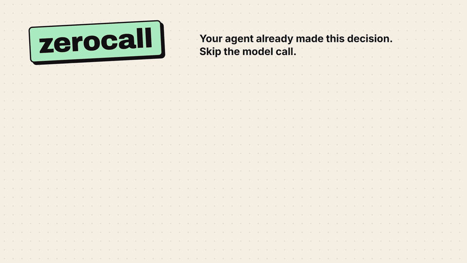

# zerocall

**Your agent already made this decision. Skip the model call, as long as nothing it depended on has changed.**




zerocall is a small Python library for tool-using agents. It stores each decision under a context signature, pins it with guards, and replays it only while every guard still holds. If the environment drifts, the guard fails and the agent decides again, so you never get a stale replay.

| | Model calls | Tokens | Wall time |
| --- | ---: | ---: | ---: |
| Cold run | 4 | 1092 | 35.86 s |
| **Warm run, same workload** | **0** | **0** | **0.08 s** |

*Formerly `decision-cache`.*

## How it works

```
task ──> signature ──> lookup ──> every guard holds? ──yes──> replay stored action   (0 calls)
                                         │
                                         no
                                         v
                                 ask the model ──> apply ──> record(action, guards)
```

`signature(task, target, intent)` hashes what the agent is being asked to do. When a decision is recorded, guards pin the state it relied on, such as a file hash, a directory listing or an allowlisted check. On lookup every guard is re-evaluated against the live environment, and a single failure means the decision is not reused.

## Measured

Run on 2026-11-02 with `py -3.12 run_demo.py` on Windows 11, backend `llm`, model `glm-4.5-flash` on `https://api.z.ai/api/paas/v4`. Tokens are the sum of the `prompt_tokens` and `completion_tokens` fields the API reported, real calls only. Raw numbers are in [`results/results.csv`](results/results.csv).

| Run | Model calls | Tokens | Wall time | Guard misses |
| --- | ---: | ---: | ---: | ---: |
| Cold (fresh cache, the model decides every task) | 4 | 1092 | 35.86 s | 0 |
| Warm (unchanged repo, cache active) | 0 | 0 | 0.08 s | 0 |

The warm phase reused 4 of 4 cached decisions.

Then the guard drill. Right after the warm phase, `demo_pkg/utils.py` was edited by hand and the sort-imports task ran again. The signature still matched, but the file hash guard failed. That miss forced exactly 1 fresh decision (293 tokens, 8.26 s), which was recorded again. The next run reused it with zero calls.

## Quickstart

Python 3.11+. Nothing to install; run it from the repo root.

```sh
python run_demo.py --backend auto      # probe the model endpoint, fall back to scripted
python run_demo.py --backend scripted  # deterministic offline policy, no credentials
python run_demo.py --model glm-4.5-flash
python -m pytest                       # 16 tests, offline
```

The `llm` backend speaks the OpenAI-compatible chat API and needs `ZAI_API_KEY`. The scripted backend answers every task deterministically and reports zero calls and zero tokens; it never estimates. The demo runs the workload cold, then warm, then the guard drill, and writes `results/results.csv`.

## API

```python
from pathlib import Path
from zerocall import DecisionCache, Guard, signature

ws = Path("repo")
cache = DecisionCache(root=ws, store=ws / ".decision_cache.json")

sig = signature("sort_imports", "pkg/utils.py", "sort the import block")
hit = cache.lookup(sig)
if hit is not None and hit.reusable:
    replay(hit.action)            # no model call
else:
    action = decide_with_model()  # fresh decision
    apply(action)
    cache.record(sig, action, guards=[
        Guard.file_hash_text("pkg/utils.py", action["content"]),  # post-state
        Guard.command_exit_code("parses", ["pkg/utils.py"]),      # still valid python
    ])
```

`record(context_signature, action, guards)` stores a decision. `lookup(context_signature)` evaluates every guard at lookup time and returns the stored action with the outcome of each guard. `result.reusable` is true only when all of them hold; otherwise the caller decides fresh and records again.

| Guard | Pins | Check |
| --- | --- | --- |
| `file_exists(path)` | presence | path exists inside root |
| `file_hash(path, digest)` | content | sha256 of the file matches (line endings normalized to LF) |
| `dir_listing(path, pattern)` | name set | hash of the sorted matching names matches |
| `command_exit_code(snippet, args, exit_code)` | external validity | allowlisted command returns the stored exit code |

Line endings are normalized to LF before hashing, so a CRLF checkout on Windows does not invalidate a decision pinned with LF.

## Safety

- File guards (`file_exists`, `file_hash`, `dir_listing`) are pure stdlib Python and never spawn a process.
- The command guard never runs free-form shell. It can only launch the current interpreter with a snippet from a fixed in-code allowlist. Right now that list has one entry, `parses`, which runs `ast.parse` on one file.
- That subprocess runs with its working directory pinned to the cache root, every path argument resolved and required to stay inside the root, and a 10 second timeout.
- It fails closed. A snippet outside the allowlist, a path that escapes the root, an unknown guard kind, or any exception during evaluation counts as a failed guard and is never raised into the agent loop.

## Limitations

- The numbers come from one four-task fixture workload, run once. Variance across repeated runs is not characterized. They say nothing about HumanEval or any other benchmark, so don't compare them to the paper's numbers.
- Savings disappear when the environment drifts, because each guard miss costs a full fresh decision. Guards only pin file content, directory listings and one allowlisted parse check. State they can't see (tool versions, environment variables, unrelated files) invalidates nothing.
- The cache doesn't judge decision quality. A wrong decision recorded with passing guards gets replayed with full confidence.
- Reuse depends on post-state pinning, so two cached tasks that write the same file supersede each other. The example workload uses one decision per target file.

## Background

zerocall is a zero-training simplification of the decision reuse mechanism in "HarnessMM: Recursive Self-Improvement for Harness Token Efficiency" (arXiv 2610.32813, Tsinghua and Microsoft Research Asia). It has no decision graphs and no recursive self-improvement, and it claims no novelty.

## Layout

```
src/zerocall/           the library (core.py, stdlib only)
examples/repo_agent.py  fixture workspace, tasks, backends, agent loop
run_demo.py             cold/warm/drill measurement harness
tests/                  pytest suite, offline
results/results.csv     raw numbers from the last demo run
```

## Citation

Source paper:

```bibtex
@misc{harnessmm2026,
  title         = {HarnessMM: Recursive Self-Improvement for Harness Token Efficiency},
  author        = {{Tsinghua University and Microsoft Research Asia}},
  year          = {2026},
  eprint        = {2610.32813},
  archivePrefix = {arXiv},
  url           = {https://arxiv.org/abs/2610.32813}
}
```

This repository:

```bibtex
@misc{zerocall2026,
  title  = {zerocall: guarded decision reuse for tool-using agents},
  author = {Gjusev},
  year   = {2026},
  url    = {https://github.com/Gjusev/zerocall}
}
```

MIT licensed, see [LICENSE](LICENSE).
